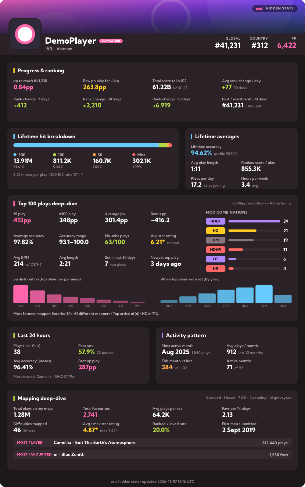

# osu! hidden stats card



A live card in the osu!lazer style that shows the stats an osu! profile **does not** display. It works for any player and updates itself (refreshed about every 15 minutes).

**App: https://osu-stats-card-nu.vercel.app**

## Make your card

1. Open **https://osu-stats-card-nu.vercel.app**.
2. Type your osu! username (or user ID) and pick a mode: osu!, taiko, catch or mania.
3. Click **Generate**, check the preview, then click **Copy**.
4. On your osu! profile, edit the **me!** section, paste the BBCode and save.

Done. The card shows your latest stats every time someone opens your profile, and its main sections are clickable (profile, ranking, top plays, beatmaps).

Prefer to write it by hand? The image link is:

```
[img]https://osu-stats-card-nu.vercel.app/card/YOUR_USERNAME.png[/img]
```

Add `?mode=taiko`, `?mode=fruits` or `?mode=mania` for other modes, and `?scale=2` for a sharper image.

> Editing the me! section requires your account to have (or have had) osu!supporter.

## What's on the card

Only things the osu! profile page doesn't show:

- **Progress & ranking**
  - pp needed to pass the player one rank above (rank ≤ 10,000)
  - raw pp a new play needs to add +1pp to the total
  - total score left until the next level, plus the exact fractional level
  - rank change over 7 / 30 / 90 days, average rank change per day, best and worst rank in the last 90 days
- **Lifetime**
  - total 300 / 100 / 50 / miss counts and their ratios
  - lifetime accuracy computed from every hit (the profile accuracy only weights top plays)
  - misses per play, average play length, ranked score per play, plays per day, hours per week
- **Top 100 deep-dive**
  - bonus pp, average pp / accuracy / star rating / BPM / length, accuracy range, no-miss plays
  - mod combinations (HDDT, HDHR…), pp distribution, the year each top play was set
  - newest top play, top plays set in the last 30 days, most-farmed mapper and artist
- **Last 24 hours:** plays including fails, pass rate, average accuracy, best pp play, most retried map
- **Activity pattern:** most active month, average plays per month over the last 12 months, this month vs last month, number of active months
- **Mapping deep-dive**
  - total plays and favourites on your own maps, plays per set, favourites per 1k plays
  - number of difficulties, average and max star rating, ranked + loved rate
  - first submitted map, most played and most favourited map
